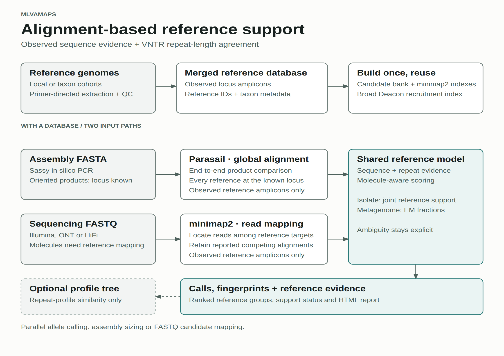

# Workflow architecture

mlvamaps has one database-construction workflow and two calling entry paths:
assembly FASTA and sequencing FASTQ. Both calling paths produce compatible
locus calls, fingerprints, profile matches, and reports, but they preserve the
different evidence available from assembled contigs and individual molecules.



[SVG](../../figures/software_workflow/mlvamaps_workflow.svg) · [PDF](../../figures/software_workflow/mlvamaps_workflow.pdf)

## Resource ownership

Reusable resources belong to the completed database, not to an individual
taxon or sample:

- `database/competitive_mapping/` owns the candidate FASTA, candidate metadata,
  provenance, and short-/long-read minimap2 indexes.
- `database/deacon/` owns the broad target-group recruitment reference and its
  Deacon index.
- Per-locus FASTAs contain observed reference amplicons for classification.
  Classification aligns Sassy-derived assembly products or FASTQ molecules to
  these sequences and combines sequence and repeat-length evidence.

A taxid build first retains each taxon's real amplicons and extraction QC in an
isolated work directory. It then merges all successful taxon outputs and builds
each reusable resource once. This is also the path for a one-row taxid build;
there is no separate per-taxon finalization followed by a duplicate combined
finalization.

Local-assembly `build-reference` input already represents one complete cohort,
so it proceeds directly from extraction to one finalization.

## Shared observed-reference mapping

FASTQ commands require `--database`. Illumina, ONT, ONT-HQ, and HiFi map directly
to observed amplicons from its per-locus FASTAs. Identical sequences are collapsed
within a locus while retaining every source reference ID. Synthetic repeat
expansions are not used as the sample's allele hypotheses in this path.

The observed target FASTA, metadata, and provenance are written under the
sample's `candidate_mapping/` directory. The existing database candidate assets
remain part of the database format and its compatibility checks; their indexes
are not used for the observed mapping. Minimap2 builds its observed target index
in memory. No reference build migration is required for current-schema databases.

Long reads undergo Sassy primer recovery before observed mapping. Paired short
reads undergo flank recruitment and mate rescue during QC. Both paths measure
molecules with the shared product parser. A reference alignment without a
measurement establishes presence. A separate fallback can report a low-confidence
`ESTIMATED` count from competing measurements, repeat-spanning CIGAR evidence,
or reference-conditioned partial mappings with flank support. Estimates remain
separate from measured molecule evidence; loci without either remain unavailable.
Primer-recovered long-read products can contribute even when mapping misses them.

The observed alignments are retained in memory for reference classification,
avoiding a second FASTQ mapping. Measured molecule repeat counts also contribute
to reference likelihoods, once per molecule even when both mates align. Sequence
mismatches and ambiguous reference memberships remain available to classification.

minimap2 emits SAM on a pipe. htslib decodes it and writes temporary compressed
BAM. Normal operation removes it; the applicable intermediate/debug flag retains
`candidate_mapping/candidate_alignments.bam`.

The long-read representative-consensus and SNP workflow still runs as a separate
confirmation stage. Its recruitment and representative mappings remain; this
change removes the repeated mapping for reference classification, not every
alignment operation in the long-read pipeline.

## Global thread budget

`--threads` is the process-wide CPU budget:

- reference extraction uses at most the resolved budget;
- native tools receive the threads allocated to their active stage;
- Illumina directory and manifest batches run independent samples concurrently;
- active sample count is bounded by sample count, CPU budget, and a memory-aware
  concurrency cap;
- each active sample receives `floor(total_threads / active_samples)` threads,
  so allocated native threads do not exceed the global budget.

The default batch cap is four active samples. Set it lower for large datasets or
memory-constrained nodes:

```bash
export MLVAMAPS_MAX_CONCURRENT_SAMPLES=2
mlvamaps call --database reference_build -i reads/ --short-reads -o results -t 32
```

Input discovery and final combined tables retain deterministic input order even
when samples finish out of order. Each sample has an isolated output directory,
and one failed sample is recorded without being interpreted as a biological
negative result.

## Progress and auditability

Unless `--quiet` is used, elapsed-time messages report phase boundaries and
counts such as taxa, assemblies, loci, candidates, and workers where available.
These messages are operational diagnostics, not biological QC. Biological
retention, dropout, ambiguity, and exclusion reasons remain in TSV and JSON
outputs and must be reviewed separately.

## Stable result boundary

Implementation details may differ between input technologies, but these public
outputs remain available:

- `calls.tsv`
- `mlva_fingerprint.tsv`
- `mlva_fingerprint_probabilistic.tsv`
- `profile_matches.tsv`
- `profile_match_loci.tsv`
- `report.html`

Do not infer biological absence from a blank repeat count. Consult the locus
status and evidence columns to distinguish not found, insufficient depth,
presence without sizing, ambiguity, filtering, and mixture evidence.
