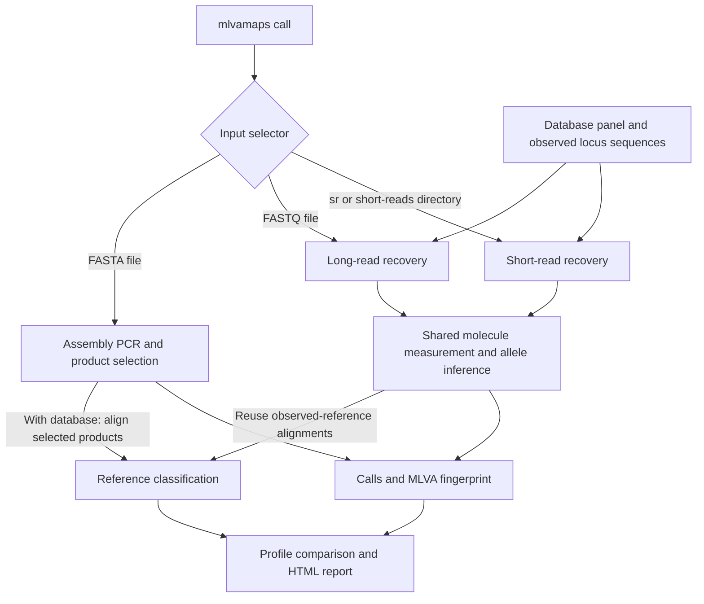
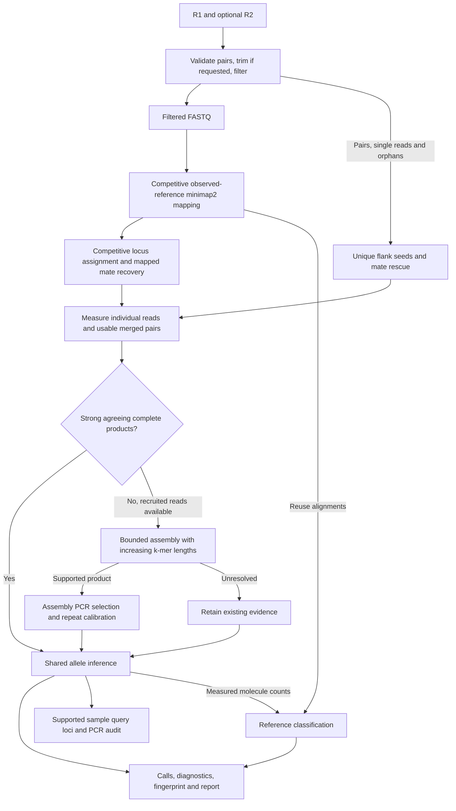
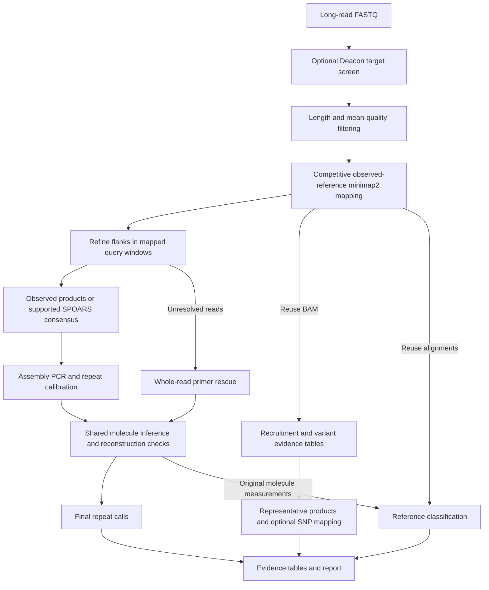
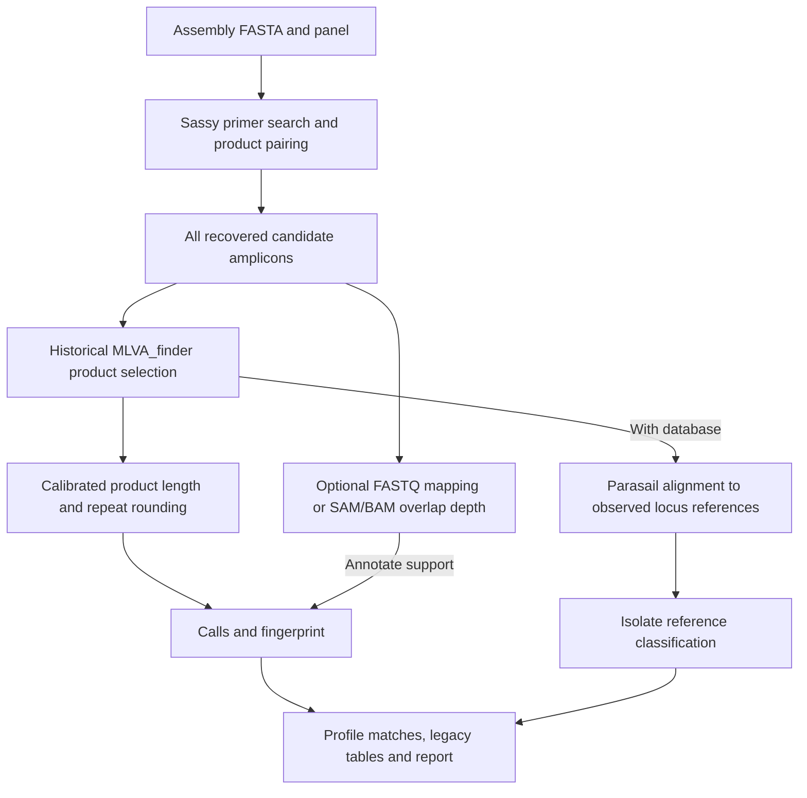

# How mlvamaps workflows work

This guide traces the current source implementation (2026-10-20), including the
observed-reference FASTQ caller and the batched Sassy searches. It describes
code paths, not a new accuracy evaluation. Function links at the end identify
the implementation behind each stage.

## Choose an input path

| Workflow | CLI selector | Required resources | Source of the repeat count |
| --- | --- | --- | --- |
| Short-read FASTQ | `-i sr --fq1 R1.fastq.gz [--fq2 R2.fastq.gz]` | Completed `--database` | Measured reads, uniquely merged pairs, or supported local products |
| Long-read/amplicon FASTQ | `-i reads.fastq.gz` | Completed `--database` | Measured molecules, including primer products recovered without mapping |
| Assembly FASTA | `-i assembly.fasta` | `-p panel.tsv` or a database containing its panel | Selected primer-bounded assembly product |

Use `-i sr` for single-end short reads as well as paired reads. A FASTQ supplied
directly to `-i` enters the long-read workflow; read length does not select the
short-read caller automatically. FASTA/FASTQ compression does not change routing.

FASTQ commands load `reference_panel.tsv` from the database unless an explicit
panel is supplied. Assembly calling can run without a database; adding one
enables sequence-based reference classification. Repeat sizing also needs panel
calibration or repeat/flank metadata: primer sequences alone do not define an
MLVA allele scale.



## What FASTQ workflows share

The mapping targets are the database's **observed per-locus amplicon sequences**.
Identical sequences within a locus share one target while retaining all source
reference IDs. The caller writes those targets and their metadata to
`candidate_mapping/`; minimap2 builds their index in memory for the sample.
The older database `competitive_mapping/` assets remain required by CLI database
validation, but their synthetic allele expansions and prebuilt indexes do not
supply the primary observed-reference mapping.

Both FASTQ paths call `run_unified_fastq_inference`:

1. Map retained reads competitively against observed targets with minimap2.
   Preserve alternative reference alignments. Decode SAM through htslib into
   temporary BAM and collect alignment evidence.
2. Measure the sample sequence using complete primer products or resolved
   repeat flanks. A reference match or paired-end geometry alone does not supply
   a direct measurement.
3. Group evidence by locus and molecule. Multiple reference alignments and two
   mates do not become independent molecule votes. Conflicting measurements
   within a molecule remain unresolved.
4. Fit raw molecule lengths and their measurement uncertainty, then apply
   assembly rounding to the selected allele. Isolate mode fits one allele with
   an outlier-tolerant likelihood; metagenome mode additionally fits allele
   fractions with EM. Identical observations share weighted likelihood rows,
   preserving molecule counts while avoiding repeated calculations. Short reads
   can additionally enter the local assembly fallback described below.
5. For unresolved calls, report a low-confidence `ESTIMATED` count when evidence
   permits: use the best ambiguous measured allele, conflicting direct
   observations, repeat-spanning CIGAR projections, or finally a reference-based
   approximation from partial mappings. Mapping estimates require flank support;
   repeat-only cross-mappings cannot establish the estimate. Average support
   over molecules without multiplying duplicate reference alignments. Keep these
   estimates separate from measured molecule counts used for classification.
6. Write `common_locus_calls.tsv` and `molecule_candidate_evidence.tsv`, then
   project the calls into the workflow's public output tables.

Supported complete sample products are checked in one batched assembly PCR pass.
Their original molecule measurements are recalibrated if the shared PCR selection
changes the allele. `query_loci.fasta` contains only products agreeing with the final
resolved call; mixed loci and unsupported sequences are omitted. The accompanying
`query_locus_reconstruction.tsv` records the reconstruction method, complete-molecule
support, PCR result and whether the sequence was exported. Complete-product selection
uses a dominant observed sequence when available. Otherwise, sufficiently supported
mapped segments are clustered by measured allele (or observed length if unmeasured)
and corrected with SPOARS before PCR. POA uses at most 100 quality-ranked independent
reads. Short reads retain the bounded fragment graph when no complete product is
available. Reference bases never fill gaps.

Both read workflows project mapping coordinates to local query windows, refine
available flanks with up to three native searches (75, 35, then 21 bases), and
measure in the mapped orientation. Searches use 24-base padding. A bounded cache
reuses identical sequence/quality/coordinate inputs without combining molecule IDs.
A supported consensus can supply the primary assembly-PCR measurement; a conflict
with a confident molecule call remains `AMBIGUOUS`, with `consensus_status=disagrees`.
Mixtures are not pooled into a single exported consensus.

`presence_support` counts detected molecules; `molecule_support` counts informative
molecules. `repeat_count_raw` preserves the selected unrounded length.
`allele_fractions` describes the mixture fit; `best_probability` remains
single-allele model support, not a mixture fraction or calibrated accuracy.
For `mapped_consensus_assembly_pcr`, `probability_kind` instead identifies the
observed reconstruction-support fraction; it is not a calibrated probability.
Novel or fractional measured alleles can be called outside the
reference catalog. Estimates carry `estimation_method`, `estimation_reason`, and
`estimate_support`; their model support is not a calibrated probability of
correctness. When neither measurement nor estimation is possible, detected loci
remain `PRESENT_COUNT_UNKNOWN`. Every panel locus appears in the report's visible
count table, with `Unavailable` when there is no usable sizing evidence. Missing
is never converted to zero.

## Short-read FASTQ

```bash
mlvamaps call --database references -i sr \
  --fq1 sample_R1.fastq.gz --fq2 sample_R2.fastq.gz \
  --sample-mode isolate --sample-id sample -o results/short -t 8
```

Omit `--fq2` for single-end data. Interleaved input is not supported. The explicit
sample mode in these examples selects isolate reference interpretation; the
CLI default is `metagenome`.



1. **Validate and filter.** Paired files must have equal record counts and
   matching normalized IDs. QC processes chunks of 5,000 pairs. Defaults retain
   reads with at least 40 bases and mean Q15; 3-prime trimming is off unless
   requested. Filtered paired reads are written to `filtered_reads_1.fastq.gz`
   and `filtered_reads_2.fastq.gz`.
2. **Recruit molecules during QC.** `FlankRecruiter` builds a lookup of 21-base flank
   seeds from observed references, excluding seeds shared across loci or found
   inside configured repeats. A pair whose seed hits identify exactly one locus
   retains both mates, including a mate with no seed hit. Single-end reads and
   surviving orphan mates use the same locus assignment. This pool supplements
   mapping; it does not filter the FASTQ sent to minimap2.
3. **Map and measure.** The shared caller uses the Illumina preset. It measures
   individual reads and merged pairs, rejecting ambiguous or repeat-only
   overlaps. Mappings recruit molecules even without exact flank seeds, requiring
   at least 21 aligned flank bases, 90% alignment identity and a ten-score margin
   over competing loci. Recruitment identity excludes indels inside the repeat
   so genuine length changes are not treated as poor mapping. Equal reference
   alleles within a locus remain eligible;
   cross-locus ties and conflicting anchored mates are excluded. Unmapped mates
   of mapped targets are recovered during BAM parsing, without rereading FASTQ.
   Recruited pairs can supply measurements independently of mapper
   success. Separate unmerged mates spanning opposite boundaries do not by
   themselves measure the intervening repeat length. Supplying both
   `--short-insert-mean` and `--short-insert-sd` from independent library
   calibration enables an `ESTIMATED` length from inward-facing, opposite-flank
   pairs when there are no direct measurements. These estimates add no measured
   molecule counts to classification.
4. **Try local assembly where needed.** If complete primer products lack strong,
   agreeing support and recruited reads exist, construct a bounded k-mer graph.
   Flank-only measurements do not bypass reconstruction. Both mapping and seed
   recruitment supply the graph.
   Start at 41 bases (or shorter for short reads), increasing by 20 bases up to
   the read-length limit, capped at 151, when needed to resolve collapsed repeats.
   Supported mappings reaching reference ends supply observed terminal seeds,
   preserving sample primer variants; reference terminal seeds are the fallback.
   Interior flank sequence comes from reads. Accept only a unique, covered,
   acyclic product. Run the assembly workflow's Sassy PCR (two primer edits),
   product selection and repeat calibration in a batch across recovered contigs.
   Graph limits are 2,000 fragments and 50,000 distinct k-mer edges per attempt.
   Branches and repeat cycles that survive all attempted sizes remain unresolved;
   reference length or coverage is not used to guess a traversal count.
5. **Call, classify, and export.** Shared inference supplies repeat calls.
   Classification reuses the original mapping and measured molecule counts.
   Outputs also include short-read QC, recruitment and assembly diagnostics,
   sample summaries, and MYOGA-compatible metadata.

Single-end reads and QC-surviving orphan mates participate in flank recruitment,
direct measurement and local assembly. Paired-mode inference still does not map
the separate `filtered_orphan_reads.fastq.gz` file: orphans contribute through
recruitment, but do not supply reference-alignment SNP evidence.

| Inspect | What it explains |
| --- | --- |
| `short_read_qc_summary.tsv` | Filtering and pair retention |
| `short_read_recruitment_summary.tsv` | Per-locus recruitment summary |
| `short_read_diagnostics.tsv` | Molecule recovery, mate rescue, graph attempts and failure reasons |
| `molecule_candidate_evidence.tsv` | Mapping and measured repeat evidence per molecule |
| `common_locus_calls.tsv` | Shared calls, informative support, ambiguity and mixtures |
| `query_loci.fasta` | Supported sample products for combined-marker export |
| `query_locus_reconstruction.tsv` | Reconstruction support, PCR validation and export eligibility |

With `--keep-intermediates`, retain filtered FASTQ files, the candidate BAM, and
short-read microassembly FASTA. Filtered paired and orphan FASTQ files are removed
at normal completion otherwise. See the [Illumina guide](docs/workflows/illumina.md)
for batch input and the full output schema.

## Long-read and amplicon FASTQ

```bash
mlvamaps call --database references -i sample.fastq.gz \
  --sample-mode isolate --sample-id sample -o results/long -t 8
```



1. **Screen and filter.** An explicit Deacon screen can precede QC; metagenome
   mode automatically uses the database's recruitment index when present.
   Current long-read code loads the resulting reads into memory before QC.
   Default QC keeps 50–100,000-base reads with mean Q15 or better and writes
   `filtered_reads.fastq.gz` and `qc_summary.tsv`.
2. **Map and refine.** Map QC reads to the observed database loci once. Competitive
   unique-flank support assigns molecules to loci; CIGAR coordinates constrain the
   flank searches. Observed complete products are measured directly. Supported
   segments with unresolved primers can enter consensus correction before PCR.
   `--read-technology ont`, `ont-hq`, or `hifi` selects the mapping preset;
   `auto` and `accurate-long` use HiFi settings. `--recruitment-preset` takes precedence.
3. **Rescue unresolved reads.** Only reads without a measured complete product
   enter whole-read Sassy PCR. `primer_rescue.fasta.gz` retains original sequence;
   the original FASTQ qualities remain attached. Tied loci or product sizes do
   not become accepted assignments. These searches remain batched.
4. **Call and retain evidence.** The shared caller checks observed products or
   supported consensus using assembly PCR and calibration. Reconstruction support
   uses original molecule IDs. Conflicting confident calls remain unresolved;
   mixed loci are not collapsed. Recruitment reuses `candidate_alignments.bam`;
   mapped-variant tables, local products, and optional representative SNP mapping
   remain available. `--no-locus-mapping` disables representative mapping.
5. **Classify and export.** Reuse observed-reference alignments and original
   measured molecule counts for classification. Export only sample products that
   agree with the final resolved call in `query_loci.fasta`. The reconstruction
   audit records support, PCR result, and export status.

| Inspect | What it explains |
| --- | --- |
| `in_silico_pcr/` | Primer search matches and recovered products |
| `read_locus_assignments.tsv` | Combined primer/recruitment assignments |
| `common_locus_calls.tsv` and `molecule_candidate_evidence.tsv` | Primary shared inference |
| `mapped_variant_table.tsv` and `vntr_mixture_abundance.tsv` | Variant grouping and estimated fractions |
| `local_locus_products.fasta.gz` and `local_assembly_concordance.tsv` | Consensus products and measurement concordance |
| `locus_mapping_summary.tsv` and `locus_snps.tsv` | Representative-mapping confirmation |

`--debug-disagreements` retains the candidate BAM and adds disagreement audit
tables. Primer-only recovery supports sizing, but does not establish a reference
identity without reference alignment evidence. See the
[FASTQ guide](docs/workflows/fastq.md) for further stage details and the synthetic
runtime measurements.

## Assembly FASTA

```bash
mlvamaps call -p panel.tsv -i assembly.fasta \
  --sample-id sample -o results/assembly -t 8
```

Add `--database references` for reference classification, or use it in place of
`-p` when its saved panel is suitable. Optional `--reads support.fastq.gz` or
`--bam assembly_reads.bam` adds depth support; these options are mutually exclusive.



1. **Find products.** Use the same Sassy-backed PCR engine, searching configured
   primer expansions with the historical strand and pairing rules. The CLI
   default permits two edits per primer. Assembly PCR permits interior `N`
   gaps and uses global product bounds covering the historical allele range;
   it does not apply each locus's rich-panel product bounds at this stage.
2. **Select the assembly product.** Preserve MLVA_finder behavior: use the first
   successful primer-error round with its strand and equal-length-match
   precedence, then choose the smallest raw allele on the last eligible FASTA
   record. Eligible raw counts must be below 100. This is historical product
   selection, so contig order can matter when several products qualify.
3. **Convert size to repeats.** With historical panel calibration, calculate
   `abs(nominal_repeat_units + (product_size_bp - expected_product_size_bp) / repeat_unit_length_bp)`.
   The shared conversion helper also supports nonrepeat/flank-based sizing when
   historical calibration is absent. Default rounding uses strict 0.25-unit
   integer boundaries, otherwise the intervening half allele;
   `--assembly-round-tolerance 0` preserves raw counts. The same conversion and
   rounding convention applies to direct FASTQ product measurements.
4. **Annotate optional support.** FASTQ support maps to extracted products with
   minimap2. Existing assembly-aligned SAM/BAM support is measured by overlap
   with product coordinates. Neither changes the selected product or count.
5. **Classify and export.** With a database, globally align selected product
   sequences to observed references at the same locus using Parasail. Feed that
   evidence into isolate reference classification. Write standard calls,
   fingerprints, profile comparisons, legacy compatibility tables, and the report.

Assembly statuses are `PASS` and `NOT_FOUND`. Here `NOT_FOUND` means no product
qualified for repeat-count selection; a recovered product can still appear in
the amplicon table when its count cannot be calculated or is out of the
historical range.

| Inspect | What it explains |
| --- | --- |
| `assembly_amplicons.tsv` and `assembly_amplicons.fasta.gz` | All recovered products and coordinates |
| `calls.tsv` | Selected product, raw/called repeat count, and optional depth |
| `read_support.tsv` | Optional read support |
| `classification/assembly_reference_evidence.tsv` | Reference-relative sequence and repeat differences |
| `legacy_output.csv` and `legacy_mlva_analysis.csv` | Historical compatibility views |

See the [assembly guide](docs/workflows/assembly.md) for the detailed PCR rules
and additional compatibility outputs.

## Reference matches and final results

Reference classification combines sequence differences and repeat-length
evidence. FASTQ passes measured counts once per molecule; unmeasured alignments
can still inform classification. Estimated locus counts are not fed back as
independent measured evidence. Isolate
mode ranks a single-source interpretation; metagenome mode fits reference
fractions with EM. Indistinguishable references remain grouped, an unclassified
component remains available, and missing-locus penalties are gated by coverage.
The model's support is conditional on the supplied reference catalog.

Start with `report.html`, `calls.tsv`, `locus_repeat_counts.tsv`, and
`mlva_fingerprint.tsv`. Use `classification/mapping_reference_matches.tsv` for
ranked reference groups, `classification/molecule_reference_likelihoods.tsv.gz`
for their underlying evidence, and `classification/classification.json` for
model diagnostics. `profile_matches.tsv` combines optional repeat-profile
comparisons with sequence-reference results. Profile trees visualize repeat
similarity and do not determine classification.

Single-input runs write directly to `-o`. Directory and manifest runs isolate
samples under `OUTDIR/<sample_id>/` and aggregate results in `batch_summary/`.
See [workflow architecture](docs/workflows/architecture.md) for thread allocation
and [output reference](docs/reference/outputs.md) for complete file descriptions.

## Source trace and checks

| Stage | Source entry points |
| --- | --- |
| CLI routing and database validation | [cli.py](mlvamaps/cli.py): `_resolve_call_args`, `_run_short_input`, `_run_single_input` |
| Short-read orchestration and QC | [short_reads.py](mlvamaps/short_reads.py): `run_short_read_call`, `qc_read_pairs`; [short_read_mapping.py](mlvamaps/short_read_mapping.py): `run_mapping_short_read_call` |
| Short-read recruitment and local assembly | [short_read_fragments.py](mlvamaps/short_read_fragments.py): `FlankRecruiter`, `assemble_fragments`, `resolve_fragment_calls` |
| Long-read orchestration | [pipeline.py](mlvamaps/pipeline.py): `run_call` |
| Shared FASTQ inference | [unified_fastq.py](mlvamaps/unified_fastq.py): `run_unified_fastq_inference`; [allele_inference.py](mlvamaps/allele_inference.py): `infer_alleles` |
| Product measurement and rounding | [locus_measurement.py](mlvamaps/locus_measurement.py): `measure_locus_product`, `find_anchor`; [calling.py](mlvamaps/calling.py): `assembly_equivalent_product_allele`, `legacy_round_repeat_count` |
| PCR batching and native search | [in_silico_pcr.py](mlvamaps/in_silico_pcr.py): `_product_rows`, `_record_batch_product_rows`; [sassy_cli.py](mlvamaps/sassy_cli.py): `Searcher.prime_many` |
| Assembly selection and outputs | [assembly_call.py](mlvamaps/assembly_call.py): `run_assembly_call`, `legacy_assembly_call_rows` |
| Observed targets and classification | [mapping_classification.py](mlvamaps/mapping_classification.py): `observed_reference_contexts`, `run_mapping_classification`, `classify_molecules` |

The implementation also avoids unnecessary short-window Sassy launches with an
in-process edit-distance existence check; accepted approximate matches still
use Sassy coordinates and traceback. The batching and precheck changes affect
execution cost, not the evidence required for a count.

Existing synthetic checks cover FASTQ/assembly concordance, primer indels,
novel and fractional alleles, primer rescue without mapping, native batch
equivalence, and anchor filtering. To run those checks with native dependencies
on `PATH`:

```bash
python -m pytest -q tests/test_fastq_assembly_concordance.py \
  tests/test_short_read_fragments.py tests/test_sassy_cli.py tests/test_short_read_runtime.py
```

Native-dependent tests skip when their tools are unavailable. These tests and
the source trace do not establish accuracy or throughput on the user's server
datasets.
